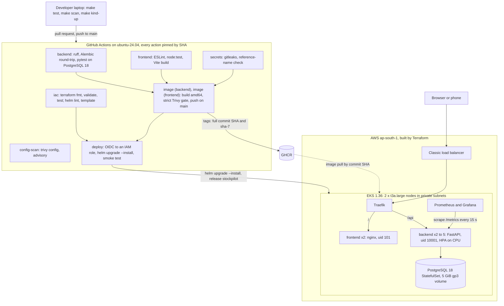
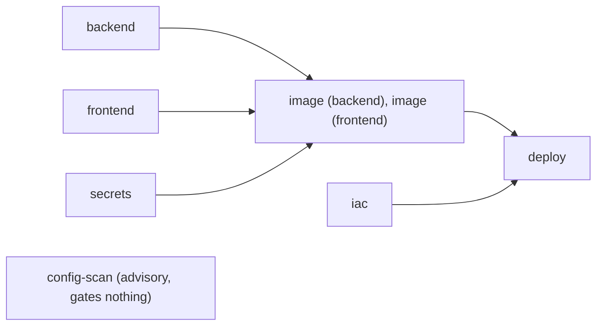

# StockPilot

**Inventory management for small shops and godowns.** Staff record stock **in and out from their
phones**. StockPilot keeps **live stock levels, stock value and days of cover** for every product,
and before festival season its **reorder planner simulates thousands of demand scenarios** to show
the **stock-out risk** of each product and **how much to reorder**.

Behind the app is the full DevOps path of the course capstone: tested FastAPI and React code,
non-root Docker images, a GitHub Actions pipeline with a strict Trivy gate and SHA-tagged images on
GHCR, Terraform for a VPC and an EKS cluster, a Helm chart with an autoscaled backend behind a
Traefik Ingress, and Prometheus with a Grafana dashboard shipped as code.

| Item | Details |
|---|---|
| Live URL | Added after the EKS session: the load balancer hostname changes on every bring-up, and `make eks-bootstrap` stores it in the `APP_URL` repository variable |
| Repository | <https://github.com/LakshyaBagani/Devops-StockPilot> |
| Screenshot | `docs/evidence/m1-03-ui-desktop-3000.png` (to capture, see the [evidence index](#12-evidence-index)) |
| Design | [docs/architecture.md](docs/architecture.md) and the [ADRs](#13-design-decisions-adrs) |
| Live demo | [docs/demo-script.md](docs/demo-script.md): commit, pipeline, deploy and autoscaling in about 10 minutes |
| Author | Lakshya Bagani |

**Status.** Everything in this repository is built and verified locally: tests on SQLite and
PostgreSQL 18, both images (strict Trivy scan clean), Docker Compose, a full kind cluster with
Traefik, the HPA and Prometheus/Grafana, offline Terraform checks and workflow linting. The steps that
need the public GitHub repository or an AWS account (pipeline runs, GHCR packages, EKS evidence, live
URL, actual spend) are described here and marked **after the GitHub repo** or **after the EKS
session**; their links and screenshots are added when they exist.

## Contents

1. [What it does](#1-what-it-does)
2. [Originality](#2-originality)
3. [Architecture](#3-architecture)
4. [API](#4-api)
5. [Run it](#5-run-it)
6. [Run the tests (M2)](#6-run-the-tests-m2)
7. [CI/CD pipeline](#7-cicd-pipeline)
8. [Security](#8-security)
9. [Infrastructure (Terraform)](#9-infrastructure-terraform)
10. [Kubernetes](#10-kubernetes)
11. [Observability](#11-observability)
12. [Evidence index](#12-evidence-index)
13. [Design decisions (ADRs)](#13-design-decisions-adrs)
14. [Limitations and future work](#14-limitations-and-future-work)
15. [Repository map](#15-repository-map)

## 1. What it does

| Who | What StockPilot gives them |
|---|---|
| Store staff | A phone-first **Record** sheet for deliveries (IN), sales (OUT) and stock-count corrections (ADJUST), and **undo** for a mistaken entry |
| Owner or manager | The **Stock** overview: on hand, value and a days-of-cover bar per product (red below one lead time, amber below two), a Reorder tag at or below the reorder point, a one-line summary, and the festival **Planner** |
| Accountant | Stock value exact to the paisa (all money is integer paise) and a **Ledger** that is never edited, only undone |
| Operator | `/health`, `/ready`, `/metrics`, `/api/version` and a footer that shows which UI and API commits are running |

What makes it more than CRUD:

- **Stock is derived, never stored.** `on_hand = SUM(delta)` over an append-only ledger, so undo is
  safe, the audit trail is complete and there is no counter to drift
  ([ADR-0005](docs/adr/0005-derived-stock-ledger.md)).
- **No overselling, even with five replicas.** Every movement locks its product row
  (`SELECT … FOR UPDATE`) before it checks and writes; five PostgreSQL-only tests prove that
  simultaneous OUTs and undos can never take stock below zero.
- **A reorder planner that does real work.** For each product it replays the shop's own lumpy
  60-day demand with late-skewed supplier lead times, thousands of times, and reports the stock-out
  probability ± a 95% margin, a recommended reorder point and an order quantity. It is tested against
  the textbook formula `ROP = d̄·L + z·σ·√L` ([ADR-0007](docs/adr/0007-reorder-planner-policy.md)).
  It is also the CPU-bound endpoint the HPA scales on.

The problem, user stories with acceptance criteria, the ER diagram, the full API contract, metrics,
seed data and wireframe notes are in **[docs/architecture.md](docs/architecture.md)**.

## 2. Originality

- **The domain is from the course's suggested list** (inventory management) and the product was
  designed and written from scratch for this capstone: the data model and migrations, the API, the
  stock ledger, the Monte-Carlo planner, the React UI, the seed data and all tests are original.
- **The DevOps layer follows the course architecture**, which GRADING.md explicitly allows
  ("The DevOps layer may follow the same architecture"): FastAPI + React + PostgreSQL, Docker and
  Compose, GitHub Actions to GHCR, Terraform for EKS, Helm, Prometheus and Grafana.
- **No code, layout or wording comes from the course reference project.** The UI deliberately avoids
  a task-tracker look (no sidebar, no stat cards, no status pills, no activity feed, no centred
  modal), and the required `secrets` CI job fails the build if the reference project's name appears
  anywhere in the repository.

Rebuilding the architecture instead of copying it also meant fixing what no longer works in the
course reference project as of October 2026:

| Problem in the course reference project | What StockPilot does instead |
|---|---|
| Terraform uses multi-argument one-line blocks, so `terraform init` fails | Multi-line HCL; `fmt -check`, `validate` and 13 mocked `terraform test` cases in CI |
| EKS 1.31 (extended-support pricing) on eks module v20 / aws provider 5, with no add-ons | EKS 1.36 on standard support, eks module 21.29.0, aws provider 6.68, explicit add-ons incl. EBS CSI and a default gp3 StorageClass |
| The Ingress points at a Service name and port the chart never creates | Every name from one Helm helper, the named port `http`, and a CI job that asserts the rendered routes |
| nginx `proxy_pass http://backend:8000` fails to resolve inside Kubernetes | An envsubst template with a runtime `resolver`, a variable `proxy_pass` and the backend's FQDN |
| `aquasecurity/trivy-action@0.30.0` no longer resolves after the March 2026 tag compromise | Every action pinned to a commit SHA, Trivy pinned to v0.75.0 ([ADR-0006](docs/adr/0006-sha-pinned-actions.md)) |
| `nginx:1.27-alpine` runs as root and carries 43 HIGH/CRITICAL findings | `nginx-unprivileged:1.30-alpine-slim` as uid 101 (0 findings), and a backend on `python:3.14-alpine` with pip removed |
| Migrations run in the container command, so two replicas race on startup | A Helm hook Job runs `alembic upgrade head` under a PostgreSQL advisory lock |
| Three tests on a module-level `TestClient`, which skips the app's startup and its schema creation | Fixtures with `with TestClient(app)`, a fresh schema per test on an isolated database, 148 test functions on SQLite and PostgreSQL |
| A deploy needs a kubeconfig secret but has no AWS credentials | GitHub OIDC to a trust-scoped IAM role, no stored keys ([ADR-0003](docs/adr/0003-github-oidc-deploy.md)) |
| The database password sits in `values.yaml` | Out-of-band Kubernetes Secrets created with `openssl rand`, never in Git |
| The Ingress uses class `nginx`, but the community ingress-nginx controller was retired in March 2026 | Traefik on kind and EKS ([ADR-0002](docs/adr/0002-traefik-ingress.md)) |
| Unpinned (`latest`) npm dependencies and no lockfile; mixed-case image names | Exact pins, `package-lock.json` and `npm ci`; lowercase GHCR names |

## 3. Architecture



The same two Dockerfiles serve every environment:

| Environment | Purpose | Command | URL | Cost |
|---|---|---|---|---|
| Local dev | Inner loop with hot reload | `make dev` | UI http://127.0.0.1:5173, API http://127.0.0.1:8000/api/docs | free |
| Docker Compose | The M4 stack and the demo fallback | `make up` | http://localhost:3000 | free |
| kind | Full rehearsal: Helm, Traefik, HPA, Prometheus, Grafana | `make kind-up && make kind-deploy` | http://localhost:8080 | free |
| EKS | Graded cloud deployment and the live demo | `make eks-up`, `make eks-bootstrap`, CI deploy | the Traefik load balancer | about $0.30/h |

**Request flow.** The browser loads the UI from nginx (`/`) and calls the API under `/api`. In
Kubernetes the Ingress sends `/api` straight to the backend Service and everything else to the
frontend; in Compose, nginx proxies `/api/` to the backend. Each write locks the product row in
PostgreSQL. **Metrics flow.** Prometheus pulls `/metrics` from every backend pod, found through a
ServiceMonitor; Grafana queries Prometheus and loads its dashboard from a ConfigMap in the chart.
Both flows are drawn step by step in [docs/architecture.md](docs/architecture.md#10-request-flow).

## 4. API

Swagger UI is served at **`/api/docs`**, so it works through nginx and the Ingress:
http://localhost:3000/api/docs (Compose), http://localhost:8080/api/docs (kind).

| Method | Path | Purpose | Responses |
|---|---|---|---|
| GET | `/api/products` | Products with on hand, value, days of cover; filters `category`, `q`, `below_reorder`, `limit`, `offset` | 200 · 422 |
| POST | `/api/products` | Create a product (SKU unique in any case) | 201 · 409 · 422 |
| GET | `/api/products/{id}` | Detail with the last 20 movements and 30-day demand | 200 · 404 |
| PUT | `/api/products/{id}` | Update any field except the SKU; explicit `null` is refused | 200 · 404 · 422 |
| DELETE | `/api/products/{id}` | Delete a product without history | 204 · 404 · 409 |
| GET | `/api/movements` | The ledger, newest first; filters `product_id`, `kind` | 200 · 422 |
| POST | `/api/movements` | Record IN, OUT or ADJUST; returns the new `on_hand` | 201 · 404 · 422 |
| GET | `/api/movements/{id}` | One ledger row | 200 · 404 |
| DELETE | `/api/movements/{id}` | Undo a mistaken entry (never below zero) | 204 · 404 · 422 |
| GET | `/api/summary` | Stock value, items at/below reorder, 24 h and 7 d activity, top 5 movers | 200 |
| GET | `/api/reorder-plan` | Monte-Carlo reorder plan: `service_level`, `horizon_days`, `surge_pct`, `scenarios`, `seed` | 200 · 422 · 503 |
| GET | `/api/version` | Version, full commit SHA and build time of the running image | 200 |
| GET | `/health` · `/ready` · `/metrics` | Liveness (no database) · readiness (`SELECT 1`) · Prometheus | 200 · 503 when not ready |

Twelve business endpoints, with GET, POST, PUT and DELETE on products. Ledger rows are deliberately
not editable, as in accounting: a wrong entry is undone and recorded again. Response shapes, bounds
and the exact error strings are in [docs/architecture.md](docs/architecture.md#5-api-contract).

## 5. Run it

`make` lists every target. `make doctor` checks the tools, the GitHub and AWS identity, the ignore
rules and the local ports.

### Docker Compose (M4)

Needs Docker with Compose v2.

```bash
make up      # docker compose up --build --wait: postgres, then backend, then frontend, each healthy
make seed    # 40 demo products with 60 days of history (safe to repeat)
open http://localhost:3000               # the UI; API docs at http://localhost:3000/api/docs
make down    # stop the stack and delete the database volume
```

`docker compose up --build` works the same; `make up` adds `--wait` and stamps the current commit
SHA into both images, which the UI footer then shows. Postgres is not published on the host; the
ports bind to 127.0.0.1 by default (`.env.example` explains how to change that). Measured: three
healthy services, and an OUT and its undo round-trip from the UI through nginx's `/api` proxy.

| Image | Build | Runs as | Size |
|---|---|---|---|
| [`backend/Dockerfile`](backend/Dockerfile) | Multi-stage on `python:3.14-alpine` (pinned by digest): a virtualenv with the runtime dependencies only (`requirements-runtime.txt` held to `constraints.txt`, no pytest or ruff), with pip removed from the venv and from the runtime image; uvicorn with one worker, `HEALTHCHECK` on `/health` | uid 10001 | 209 MB |
| [`frontend/Dockerfile`](frontend/Dockerfile) | Multi-stage: `node:24-alpine` runs `npm ci` and `vite build`, then `nginxinc/nginx-unprivileged:1.30-alpine-slim` (pinned by digest) serves the static files on port 8080 and proxies `/api/` through a runtime template; `HEALTHCHECK` on `/healthz` | uid 101 | 30.5 MB |

Compose starts exactly three services, each waiting until the previous one is healthy: `postgres`
(`pg_isready`), then `backend` (`python -m app.prestart` migrates, then uvicorn; healthy once `/ready`
answers), then `frontend`. The same Dockerfiles build the images for kind (local builds loaded into
the cluster) and EKS (the amd64 images CI pushes to GHCR).

### kind (free rehearsal of the whole cluster)

Needs kind 0.33, kubectl, Helm 4.3 and about 8 GB of Docker memory.

```bash
make kind-up        # cluster + namespaces, Secrets, metrics-server, Traefik, kube-prometheus-stack
make kind-deploy    # build both images, kind load, helm upgrade --install, helm test, seed, smoke test
open http://localhost:8080
make loadtest       # planner load: the backend HPA goes from 2 to 5 replicas
make loadtest-stop  # back to 2 about a minute and a half later
make evidence ENV=kind MODULE=all   # the M8/M9 commands with their output; holds the port-forwards open
make kind-down
```

Measured on kind: `make kind-deploy` installs in about 1 min 22 s and `helm test` passes; the HPA
reached 5 replicas 44 s after `make loadtest` and was back to 2 replicas 92 s after
`make loadtest-stop`; a second-tag upgrade served 206 of 206 probe requests with HTTP 200 while the
pre-upgrade migration Job finished before the first new pod started.

### EKS (the graded cloud deployment)

Each billable step is run by hand in a terminal and stops at a typed confirmation. The full runbook,
with expected output and troubleshooting, is [terraform/README.md](terraform/README.md).

```bash
make eks-preflight     # read-only AWS checks: identity, versions, instance types, quota, budget
make eks-oidc          # once, free: IAM-only apply of the GitHub OIDC provider and deploy role (type yes)
make eks-up            # plan, then apply only after you type APPLY (about $0.30/h from here on)
make eks-bootstrap     # namespaces, Secrets, Traefik and its load balancer, monitoring, repo variables
gh variable set DEPLOY_ENABLED --body true -R LakshyaBagani/Devops-StockPilot   # then push to main or dispatch ci-cd
kubectl --context stockpilot-eks -n stockpilot exec deploy/stockpilot-backend -- python -m app.seed
make evidence ENV=eks MODULE=all
make eks-down          # ordered teardown, AWS-side gates, terraform destroy (type yes), leftover sweep
make leftovers         # all-region sweep: exit 1 if anything billable is left
```

Status: not run yet. The EKS results (plan, console screenshots, deploy run, live URL, destroy) are
added after the EKS session.

## 6. Run the tests (M2)

**Requirement:** Python 3.11 or newer (3.14 recommended). macOS's built-in `/usr/bin/python3` is 3.9
and will not work. The tests use in-memory SQLite by default, so nothing else has to run.

```bash
cd backend
python3 -m venv .venv && . .venv/bin/activate
pip install -r requirements.txt
pytest -v
```

**No Python installed?** Run the same suite in a throwaway container (the source is mounted
read-only):

```bash
docker run --rm -e PYTHONDONTWRITEBYTECODE=1 -v "$PWD/backend:/src:ro" -w /src python:3.14-slim \
  sh -c 'pip install -q -r requirements.txt && pytest -v -p no:cacheprovider'
```

Both commands were run on a fresh clone on 2026-10-15: **279 passed, 5 skipped** on Python 3.14.8
(4.1 s in the venv, 4.5 s in the container), and the same result on Python 3.11.17 (the container
command with `python:3.11-slim`), which backs the 3.11 minimum.

How to read the output:

- The header prints two lines. `test-db: sqlite in-memory (fresh schema per test, discarded after the
  run)` is the database the tests use. `app-db: postgresql+psycopg://stockpilot@localhost:5432/stockpilot
  (never used by tests; tripwire armed)` is the app's own database, which the tests are forbidden to
  touch. This header is the proof that tests never hit a real database.
- The **5 skipped** tests are the PostgreSQL-only concurrency proofs in
  `tests/test_concurrency_pg.py` (`needs PostgreSQL row locks; run make test-pg`). SQLite has a single
  writer and no row locks, so there is nothing to prove there.

**On PostgreSQL 18:** `make test-pg` starts a throwaway `postgres:18-alpine` container on
127.0.0.1:55432 with the database `stockpilot_test`, runs the Alembic cycle
(`upgrade head`, `check`, `downgrade base`, `upgrade head`) on a separate database, runs the suite,
and deletes the container. It never touches the Compose database or port 5432. Measured: the
Alembic cycle is clean, then **284 passed, 0 skipped** in about 27 s.

| Layer | What is tested |
|---|---|
| Unit | Stock maths (on hand = Σ delta, integer-paise value, days of cover), the planner against the textbook ROP oracle, monotonicity, zero demand, surge, seeded determinism, the margin formula, `median_low` |
| API | FastAPI `TestClient` with the `get_db` dependency overridden and a fresh schema per test: every endpoint, status codes, the exact error strings, the 422 bounds, `null` on PUT, duplicate SKUs in any case, delete with history (409) |
| Concurrency (PostgreSQL only) | Two simultaneous OUTs cannot oversell; parallel OUTs, undo racing OUT, and double undo, all under `FOR UPDATE` |
| Metrics | Business counters move only after a commit, series exist at 0 before traffic, probes are not instrumented, the planner histogram and scenario counter |
| Isolation guard | `TEST_DATABASE_URL` must be in-memory SQLite or a database whose name ends in `_test` and differs from the app's; a tripwire fails any connection through the app's own engine |
| Migrations | `alembic upgrade`, `check` and `downgrade` on PostgreSQL in CI and `make test-pg` |
| CI | The `backend` job runs ruff, the Alembic round-trip and `pytest -v` on a PostgreSQL 18 service with separate Alembic and test databases (`TEST_REQUIRE_POSTGRES=1`, so it can never silently fall back to SQLite) |
| Coverage | 99.47% on SQLite and 99.73% on PostgreSQL; the gate is `fail_under = 85` in `pyproject.toml`, and CI writes the table to the job summary |

The suite has 148 test functions (284 cases with parametrisation); `backend/pytest.ini` and
`backend/conftest.py` configure it. The frontend has its own `node:test` suite (`make lint-frontend`).
Links to the green CI run and PR-A are added after the GitHub repo exists; the screenshot is
`docs/evidence/m2-01-pytest-v.png` (to capture from `make test-pg` on the final `main`).

## 7. CI/CD pipeline

One workflow, [`.github/workflows/ci-cd.yml`](.github/workflows/ci-cd.yml). Job ids are the check
names, and every action is pinned to a commit SHA.



| Job | What it does |
|---|---|
| `backend` | `pip install -r requirements-dev.txt -c constraints.txt`, ruff check and format check, the Alembic round-trip, `pytest -v` with coverage on a PostgreSQL 18 service, the JUnit report as an artifact |
| `frontend` | `npm ci`, ESLint plus the design guardrails, `npm test`, `vite build` with the commit SHA baked in |
| `secrets` | gitleaks (new commits on PRs and pushes, the full history on dispatch and the weekly schedule) and the reference-name check |
| `iac` | `terraform fmt -check`, `init -backend=false`, a lock-file drift check, `validate`, `terraform test` with mocked providers; `helm lint` and `helm template` for both overlays and assertions on the rendered Ingress, Services, ServiceMonitor and image tags |
| `config-scan` | `trivy config` over the Dockerfiles, chart and Terraform, uploaded as SARIF; report-only |
| `image` | A matrix over backend and frontend: build linux/amd64 and load it locally, **Trivy gate (HIGH/CRITICAL, strict)**, a SARIF report to the Security tab, then on `main` only log in to GHCR and push exactly the scanned image |
| `deploy` | On `main` when `DEPLOY_ENABLED` is `true`: GitHub OIDC to the AWS role, `aws eks update-kubeconfig`, `helm package` with the commit as app version, `helm upgrade --install --rollback-on-failure --wait` with both values files, then a smoke loop until `$APP_URL/api/version` reports this commit |

- **Triggers:** push to `main`, pull requests to `main`, manual dispatch, and a weekly schedule
  (Monday 03:17 UTC) that runs only `secrets` and `config-scan`.
- **Gates:** red tests, lint, migrations, frontend build or secrets scan ⇒ no images are built. Any
  HIGH/CRITICAL in an image, unfixed included ⇒ that image is not pushed. A failed rollout ⇒ Helm
  rolls back on its own, and the smoke test fails the job unless the live SHA is the new one.
- **Tags:** `ghcr.io/lakshyabagani/stockpilot-backend` and `-frontend`, each tagged with the full
  40-character commit SHA and `sha-` plus its first 7 characters; never `latest`. The deploy sets both
  image tags and `backend.gitSha` to the same commit.
- **Required checks on `main`:** `backend`, `frontend`, `iac`, `secrets`, `image (backend)`,
  `image (frontend)`, added to branch protection after the first all-green run on GitHub.
- **Deploy without keys:** the `deploy` job runs in the `production` environment (branch `main` only)
  and assumes `stockpilot-gha-deploy` through GitHub OIDC ([ADR-0003](docs/adr/0003-github-oidc-deploy.md)).
  The repository variable `DEPLOY_ENABLED` keeps the pipeline green while no cluster exists.
- **Proof that the gates bite:** two pull requests stay open and unmerged. **PR-A** changes one
  expected value in `test_on_hand_is_sum_of_movements`, so `backend` fails and no image is built.
  **PR-B** changes only the frontend runtime base to `nginx:1.27-alpine`, so the tests pass, the image
  builds, and `image (frontend)` fails at the strict Trivy gate.
- **Checked locally:** actionlint and zizmor are clean on both workflows. The workflows have not run on
  GitHub yet; the links to the latest green run, PR-A, PR-B and both GHCR package pages are added
  after the GitHub repo exists.

## 8. Security

### Security scan explained

**What Trivy scanned and what the result means (M6).** In every pipeline run, Trivy scans both images
after they are built and before they may be pushed: the Alpine OS packages of each image, plus the
Python libraries installed in the backend (the frontend image holds only nginx and static files, no
Node packages). The gate step fails the job on any HIGH or CRITICAL finding, including findings that
have no fix yet, so a vulnerable image never reaches GHCR or the cluster. Result for both StockPilot images: **0 HIGH/CRITICAL, strict mode (unfixed included),
Trivy 0.75.0, DB 2026-10-15**, from `make scan` (the CI gate's flags on linux/amd64 builds;
`.trivyignore` has no active entries). The pipeline's own scan tables are added after the GitHub repo
exists.

**One CVE explained: what the gate stops.** PR-B swaps only the frontend runtime base for the stale
`nginx:1.27-alpine`. Scanned locally with the gate's flags on 2026-10-15, that base fails with 43
findings (41 HIGH, 2 CRITICAL). The top one:

| CVE | Package | Installed → fixed | Severity | Where it comes from |
|---|---|---|---|---|
| CVE-2026-31789 | `libcrypto3` and `libssl3` (OpenSSL) | 3.3.3-r0 → 3.3.7-r0 | CRITICAL (NVD, CVSS 3.1 score 9.8) | The Alpine 3.21.3 layer of `nginx:1.27-alpine` |

- **What it is.** A heap buffer overflow in OpenSSL: converting an excessively large OCTET STRING to
  hex, as when printing or logging the key identifier extensions of a crafted X.509 certificate,
  computes the buffer size as length × 3, which overflows on 32-bit platforms. The result can be a
  crash or, possibly, code execution. OpenSSL itself rated it Low (it needs a certificate over 1 GB and
  a 32-bit build), but Trivy takes the NVD rating for this Alpine package, so the gate sees CRITICAL.
- **How it got in.** `nginx:1.27-alpine` was last built on 2025-04-16 (nginx 1.27.5 on Alpine 3.21.3)
  and that tag has not been rebuilt since, so it still carries OpenSSL 3.3.3-r0; Alpine's fixed
  package 3.3.7-r0 only reaches images that are rebuilt. nginx links OpenSSL for TLS, so the library is
  there whether or not TLS is used.
- **Why StockPilot is clean.** The package is **patched in our base**: the digest-pinned
  `nginxinc/nginx-unprivileged:1.30-alpine-slim` (built 2026-10-14 on Alpine 3.24.2) ships OpenSSL
  3.5.9-r0, and re-scanning it with the gate's flags gives **0 HIGH/CRITICAL** (its only finding at any
  severity is one MEDIUM in zlib). Of the 43 findings in the stale base, 21 are in packages our base has
  at patched versions (OpenSSL, musl, zlib), and 22 are in packages the slim variant does not ship at
  all (libexpat, libpng, libxml2, tiff, c-ares, nghttp2). Our base also runs as uid 101 on port 8080
  instead of root.
- **Why fail on it anyway.** Even on the stale base this bug would not be reachable, because the images
  are built for 64-bit platforms. The gate is a policy rather than a triage: when a fixed base exists,
  the build stays red until it is used.
- The PR-B run link is added after the GitHub repo exists. The vulnerability database changes daily,
  so if that run's top finding differs, this table is refreshed from its log.

**The strict result in detail.** Both images use Alpine bases pinned by digest: `python:3.14-alpine`
for the backend's build and runtime stages, with pip uninstalled, and
`nginxinc/nginx-unprivileged:1.30-alpine-slim` for the frontend; both run as non-root numeric users.
Scanned bare on 2026-10-15, `python:3.14-alpine` has no HIGH/CRITICAL findings in its OS packages,
and its only four HIGH findings are in pip's vendored msgpack, setuptools and urllib3, which leave the
image together with pip. The Debian `python:3.14-slim` was rejected: 44 HIGH findings in its Debian
13.7 packages, none with a fix available, so a strict gate on it could never pass. Documented
exceptions: none. The SARIF report step ignores `.trivyignore`, so the Security tab always shows every
finding unsuppressed.

**If the gate turns red later** (a new CVE in a pinned base), the fix follows one ladder, written at
the top of `.trivyignore`: bump the base digest; else bump the dependency pin; else upgrade the one
package in the runtime stage; and only for an unfixed CVE with no alternative, a dated `.trivyignore`
entry with a reason and an owner, plus an exceptions table here. `ignore-unfixed` is never used.

**Supply chain (CVE-2026-33634).** In March 2026 the `aquasecurity/trivy-action` repository was
compromised: almost every release tag was force-pushed to commits that stole CI secrets, and pipelines
that referenced the action by tag ran the attacker's code. StockPilot pins every action to a full
commit SHA, which cannot be moved, pins Trivy itself to v0.75.0, and enforces SHA pinning in the
repository settings once the repository exists ([ADR-0006](docs/adr/0006-sha-pinned-actions.md)).

**Reproduce locally:** `make scan` (both images, strict flags, exit 1 on any HIGH/CRITICAL).

### Other controls

- **Non-root everywhere:** backend uid 10001 and frontend uid 101 (`docker run --rm IMAGE id`, see
  `docs/evidence/terminal/m4-04-nonroot-id.txt`). In Kubernetes the pods also run with a read-only
  root filesystem, all capabilities dropped, no privilege escalation and seccomp `RuntimeDefault`; the
  namespace enforces Pod Security `baseline` and warns at `restricted`. PostgreSQL is the documented
  exception ([ADR-0004](docs/adr/0004-in-cluster-postgres.md)).
- **No secrets in Git:** `.env`, `terraform.tfvars`, state and plans are git-ignored. The database and
  Grafana passwords are created in-cluster with `openssl rand` by `make kind-up` or
  `make eks-bootstrap`. Run `make gitleaks` before every push; the required `secrets` job scans every
  PR and push and the full history weekly. GitHub secret scanning with push protection is part of the
  repository setup.
- **Least privilege in CI:** the workflow default is `contents: read`; only `image` may write packages
  and only `deploy` and `whoami` may request an OIDC token.
- **Base images pinned by digest;** `make digests` reports drift, and the remediation ladder above
  handles it.

[SECURITY.md](SECURITY.md) has the reporting policy and the full list of controls.

## 9. Infrastructure (Terraform)

[`terraform/`](terraform/) builds the AWS side in `ap-south-1` (Mumbai). Every billable command is run
by hand and stops at a typed confirmation; nothing applies from CI.

| Resource | Details |
|---|---|
| VPC | `10.0.0.0/16` over 2 availability zones; 2 public /24 subnets tagged for internet-facing load balancers, with a route to the internet gateway; 2 private /20 subnets for the nodes; 1 NAT gateway |
| EKS | `stockpilot-eks`, Kubernetes 1.36 on standard support, public API endpoint with IAM authentication, access entries, Secrets encrypted with KMS |
| Node group | 2 × `t3a.large` (fallback `t3.large`; `m7i-flex.large` on Free-plan accounts), AL2023, on-demand, min 2 / max 3, private subnets only |
| Add-ons | vpc-cni, eks-pod-identity-agent, kube-proxy, coredns, metrics-server, aws-ebs-csi-driver with a default gp3 StorageClass |
| GitHub OIDC | Provider (unless it exists) and the deploy role, trusted only for this repository's `production` environment |

- **Checked offline:** `make tf-check` passes: `fmt -check`, `init -backend=false`, `validate` and 13
  `terraform test` cases with mocked providers (no AWS call). The planned creates are pinned by those
  tests: **65** on a fresh account (64 when GitHub's OIDC provider already exists), **3** (2) for the
  IAM-only `make eks-oidc`, and **62** for `make eks-up` after it.
- **Not applied yet.** The `terraform plan` output, the VPC and EKS console screenshots and the
  `terraform destroy` result are added after the EKS session.
- `terraform.tfvars.example` is committed with placeholders that fail validation; the real
  `terraform.tfvars` is git-ignored and holds no credentials. `allowed_account_ids` stops a wrong AWS
  profile from planning, applying or destroying anything.

**Cost** (ap-south-1 list prices checked 2026-10-14, details in
[terraform/README.md](terraform/README.md#9-cost)):

| Item | $/hour |
|---|---|
| EKS control plane, standard support | 0.10 |
| 2 × t3a.large on-demand | 0.0986 |
| NAT gateway (+ $0.056/GB processed) | 0.056 |
| Classic load balancer (Traefik) | 0.0266 |
| 3 public IPv4 addresses | 0.015 |
| About 45 GiB of gp3 (node disks and PostgreSQL) | about 0.006 |
| KMS key | about 0.0014 |
| **Total** | **about 0.30** |

That is about $1.8 for a 6-hour session and about $50 for a week if forgotten, plus 18% GST. The plan
is three short sessions (evidence, rehearsal, demo): $8–13 including GST with one overnight keep
before the demo, about $6 without. **Actual spend** is added after the EKS sessions, from the Billing
console.

**Teardown discipline:**

- `make eks-down` runs the teardown in a fixed order: it sets `DEPLOY_ENABLED=false` first and waits
  for running pipelines, uninstalls the app and deletes its PVCs (so the EBS volumes go), uninstalls
  monitoring and Traefik (which deletes the load balancer), waits until no load balancer, target group,
  `k8s-*` security group or tagged EBS volume is left in the VPC, and only then runs
  `terraform destroy`, which you confirm by typing `yes`.
- `make leftovers` then sweeps every region for clusters, instances, NAT gateways, Elastic IPs, load
  balancers, volumes and VPCs, and exits 1 if anything billable remains.
- A $10 monthly budget (credits excluded) with three alerts, and Cost Anomaly Detection, are part of
  the Day-0 account setup before the first apply; they live outside Terraform, so a destroy never
  deletes them.
- A live cluster is never re-applied, and every session ends with a destroy on the same day, except
  one overnight keep when the demo is the next calendar day.

## 10. Kubernetes

The chart [`helm/stockpilot`](helm/stockpilot/) deploys the whole app with one
`helm upgrade --install`; `values.yaml` holds production defaults, `values-kind.yaml` and
`values-eks.yaml` layer on top, and CI always passes both files.

| Object | Details |
|---|---|
| Namespaces | [`k8s/namespace.yaml`](k8s/namespace.yaml): `stockpilot` (Pod Security enforce `baseline`, warn/audit `restricted`), `monitoring`, `traefik` |
| Backend Deployment | 2–5 replicas (the HPA owns the count, so the Deployment sets none); rolling update with `maxUnavailable: 0`, `maxSurge: 1`; requests 100m CPU / 128Mi, limits 500m / 256Mi; env from a ConfigMap and the `stockpilot-db` Secret |
| Probes | startup `/health` (2 s × 30), readiness `/ready` (`SELECT 1`, timeout 3 s), liveness `/health` (timeout 5 s, 6 failures); `preStop` sleep 5 s so endpoint removal reaches Traefik before shutdown |
| HPA | `autoscaling/v2` on CPU: min 2, max 5, target 60%; scale-down stabilisation 60 s for the demo (Kubernetes defaults to 300 s) |
| Frontend Deployment | 2 replicas of nginx on port 8080, probes on `/healthz`, `API_UPSTREAM` set to the backend's FQDN, `emptyDir` for `/tmp` and nginx's `conf.d` under a read-only root filesystem |
| Services | ClusterIP: `stockpilot-backend` (port name `http`, 8000), `stockpilot-frontend` (80 → 8080), `stockpilot-postgres` (5432) |
| Ingress | Class `traefik`, no host: `/api` → `stockpilot-backend:http`, `/` → `stockpilot-frontend:80` ([ADR-0002](docs/adr/0002-traefik-ingress.md)) |
| PostgreSQL | StatefulSet, 1 replica, 5 GiB PVC on the default StorageClass, credentials from the out-of-band Secret ([ADR-0004](docs/adr/0004-in-cluster-postgres.md)) |
| Migrations | A hook Job (`post-install,pre-upgrade`) runs `alembic upgrade head` under a PostgreSQL advisory lock, deleted on success, so pods never race on the schema |
| PDBs | `minAvailable: 1` for backend and frontend |
| Monitoring | A ServiceMonitor (rendered only when its CRD exists) and the Grafana dashboard ConfigMap |
| `helm test` | A pod from the backend image checks the routes, the deployed SHA, the migrated schema and nginx's proxy |

Every pod in `stockpilot` is Running: hook and test pods are deleted on success, the load generator
runs in `default`, and the troubleshooting labs in their own `stockpilot-lab` namespace.
[troubleshooting/RUNBOOK.md](troubleshooting/RUNBOOK.md) has the diagnosis toolkit, Helm recovery,
known failure modes and three failure labs (wrong image tag, Service selector mismatch, readiness
probe on the wrong path).

**Planner sizing.** The default plan (1,000 scenarios, 30 days, 40 products) takes about 0.29 s of
compute in a backend pod on kind, inside the 0.2–0.5 s target, so `PLANNER_DEFAULT_SCENARIOS` stays at
1000. The calibration on the EKS node type is added after the EKS session.

## 11. Observability

**How metrics flow.** Prometheus uses a pull model: it scrapes HTTP endpoints on a schedule, and
nothing in the app pushes. kube-prometheus-stack 92.7.0 runs in `monitoring`. Its Prometheus selects
ServiceMonitors in all namespaces; the chart's ServiceMonitor selects the backend Service by its
labels and names the endpoint by the port name `http`; the Service's EndpointSlices list the backend
pods; and Prometheus scrapes `/metrics` on each pod every 15 seconds, so pods the HPA adds become
targets without any change. `/metrics`, `/health` and `/ready` are excluded from the request
metrics, so probe traffic does not dilute the request rate. Latency percentiles use
`http_request_duration_highr_seconds`, the instrumentator's fine-bucket histogram:
`histogram_quantile` interpolates inside a bucket, so the coarse per-handler histogram would give a
vague p95. Prometheus and Grafana are never exposed publicly; they are reached with
`kubectl port-forward`, and Grafana's admin password lives in a Secret created at bootstrap. The
diagram is in [docs/architecture.md](docs/architecture.md#11-metrics-flow).

**Dashboard as code:** [`helm/stockpilot/dashboards/stockpilot.json`](helm/stockpilot/dashboards/stockpilot.json),
uid `stockpilot-overview`, 11 panels and 17 queries, loaded by Grafana's sidecar from a ConfigMap.
Panels 1, 2, 3, 5, 6, 7 and 9 are the core set used in the demo.

| # | Panel | PromQL (`$namespace` is `stockpilot`) |
|---|---|---|
| 1 | Requests/s by route | `sum by (handler) (rate(http_requests_total{namespace="$namespace"}[$__rate_interval]))` |
| 2 | p95 latency, all routes | `histogram_quantile(0.95, sum by (le) (rate(http_request_duration_highr_seconds_bucket{namespace="$namespace"}[$__rate_interval])))` |
| 3 | 5xx error ratio | `(sum(rate(http_requests_total{namespace="$namespace",status="5xx"}[$__rate_interval])) or vector(0)) / clamp_min(sum(rate(http_requests_total{namespace="$namespace"}[$__rate_interval])), 1e-9)` |
| 4 | In-flight requests | `sum by (handler) (http_requests_inprogress{namespace="$namespace"})` |
| 5 | Backend replicas | `kube_horizontalpodautoscaler_status_current_replicas`, `…_desired_replicas` and `…_spec_max_replicas` for `stockpilot-backend` |
| 6 | Backend CPU used / requested | `sum by (pod) (rate(container_cpu_usage_seconds_total{namespace="$namespace",container="backend"}[$__rate_interval])) / sum by (pod) (kube_pod_container_resource_requests{namespace="$namespace",container="backend",resource="cpu"})` |
| 7 | Running image tag | `kube_pod_container_info` counted by image, with the tag extracted: it flips when a deploy lands |
| 8 | Stock movements | `sum by (kind) (rate(stockpilot_movements_total[…])) * 60` and OUT units per hour |
| 9 | Planner p95 vs backend replicas | `histogram_quantile(0.95, …stockpilot_planner_seconds_bucket…)` against the HPA's current replicas |
| 10 | Rejected OUTs and undos | `stockpilot_insufficient_stock_total` and `stockpilot_undo_total` rates per minute |
| 11 | Planner work and bulkhead | `stockpilot_planner_scenarios_total` rate and `stockpilot_planner_inflight` per pod |

Measured on kind: the target pool `serviceMonitor/stockpilot/stockpilot-backend/0` is up (5 of 5
targets during the load test), and after a load window with UI actions all 17 queries return data.
The business metrics and their meaning are listed in
[docs/architecture.md](docs/architecture.md#8-metrics). Port-forwards for the evidence (ports that
never clash with Compose):

```bash
kubectl -n stockpilot port-forward svc/stockpilot-backend 18000:8000                 # curl localhost:18000/metrics
kubectl -n monitoring port-forward svc/kube-prometheus-stack-prometheus 19090:9090   # http://localhost:19090/targets
kubectl -n monitoring port-forward svc/kube-prometheus-stack-grafana 13000:80        # http://localhost:13000/d/stockpilot-overview
```

## 12. Evidence index

Every "What to Submit" item of GRADING.md, and where it is. **In repo** links the file.
**Transcript** links a committed terminal record (`docs/evidence/terminal/` for Compose, Docker and
Git; `docs/evidence/kind/terminal/` for the kind cluster, a backup of the EKS shots). **To capture**
is a PNG still to take locally; **after GitHub** and **after EKS** are PNGs that need the public
repository or an AWS session. Every PNG goes into `docs/evidence/` under the name shown.

| Module | What to Submit (GRADING.md) | Evidence | Status |
|---|---|---|---|
| M1 | `backend/app/`: Python sources | [`backend/app/`](backend/app/) (models, schemas, routers, services, database config) | In repo |
| M1 | `backend/alembic/versions/`: a migration | [`0001_initial.py`](backend/alembic/versions/0001_initial.py) | In repo |
| M1 | `backend/requirements.txt` | [`backend/requirements.txt`](backend/requirements.txt) | In repo |
| M1 | `frontend/`: frontend sources | [`frontend/`](frontend/) | In repo |
| M1 | `docker-compose.yml` | [`docker-compose.yml`](docker-compose.yml) | In repo |
| M1 | Screenshot of the running app in the browser | `m1-03-ui-desktop-3000.png`, `m1-04-ui-mobile-3000.png` | To capture |
| M1 | (supporting) Swagger UI with every endpoint | `m1-01-swagger-api-docs.png` | To capture |
| M1 | (supporting) `/health` answers | [transcript](docs/evidence/terminal/m1-02-health-curl.txt); `m1-02-health-curl.png` | Transcript; PNG to capture |
| M1 | (supporting) Alembic history and the tables | [transcript](docs/evidence/terminal/m1-05-alembic-history-psql-dt.txt); `m1-05-alembic-history-psql-dt.png` | Transcript; PNG to capture |
| M2 | `backend/tests/` | [`backend/tests/`](backend/tests/) | In repo |
| M2 | `backend/pytest.ini` or `backend/conftest.py` | [`pytest.ini`](backend/pytest.ini), [`conftest.py`](backend/conftest.py) | In repo |
| M2 | Terminal screenshot of `pytest -v` passing | `m2-01-pytest-v.png`, from `make test-pg` on the final `main` | To capture |
| M3 | GitHub repository URL | `https://github.com/LakshyaBagani/Devops-StockPilot` | After GitHub |
| M3 | Commit history screenshot (at least 10 commits) | `m3-01-commits.png` (over 60 conventional commits) | After GitHub |
| M3 | (supporting) `.gitignore` covers `.env`, `__pycache__`, `node_modules`, `.venv` | [transcript](docs/evidence/terminal/m3-02-gitignore.txt); `m3-02-gitignore.png` | Transcript; PNG to capture |
| M4 | `backend/Dockerfile` | [`backend/Dockerfile`](backend/Dockerfile) | In repo |
| M4 | `frontend/Dockerfile` | [`frontend/Dockerfile`](frontend/Dockerfile) | In repo |
| M4 | `docker-compose.yml` | [`docker-compose.yml`](docker-compose.yml) | In repo |
| M4 | Terminal screenshot of `docker compose up --build` | [transcript](docs/evidence/terminal/m4-01-compose-up-build.txt) and [`compose ps`](docs/evidence/terminal/m4-02-compose-ps.txt); `m4-01-compose-up-build.png`, `m4-02-compose-ps.png` | Transcripts; PNGs to capture |
| M4 | Browser at http://localhost:3000 | `m4-03-browser-localhost-3000.png` | To capture |
| M4 | (supporting) Both images run as non-root | [transcript](docs/evidence/terminal/m4-04-nonroot-id.txt); `m4-04-nonroot-id.png` | Transcript; PNG to capture |
| M4 | (supporting) The backend image builds | [transcript](docs/evidence/terminal/m4-05-docker-build-backend.txt); `m4-05-docker-build-backend.png` | Transcript; PNG to capture |
| M5 | `.github/workflows/` | [`ci-cd.yml`](.github/workflows/ci-cd.yml), [`whoami.yml`](.github/workflows/whoami.yml) | In repo |
| M5 | Actions run URL of a green pipeline | Run URL and `m5-01-green-run.png` (the push run whose deploy is green) | After GitHub and EKS |
| M5 | GHCR package pages with SHA tags | `m5-03-ghcr-backend-tags.png`, `m5-04-ghcr-frontend-tags.png` | After GitHub |
| M5 | (supporting) A failing test blocks the images (PR-A) | `m5-02-pr-a-red.png` and the PR-A link | After GitHub |
| M6 | Trivy scan step in the workflow | Step "Trivy gate (HIGH/CRITICAL, strict)" in [`ci-cd.yml`](.github/workflows/ci-cd.yml) | In repo |
| M6 | Screenshot of the Trivy output from a pipeline run | `m6-01-trivy-backend.png`, `m6-02-trivy-frontend.png`; the red gate `m6-03-pr-b-red.png` | After GitHub |
| M6 | 2–3 sentences on what Trivy scanned and the result | [Security scan explained](#security-scan-explained) | In repo |
| M7 | `terraform/`: all `.tf` files | [`terraform/`](terraform/) | In repo |
| M7 | `terraform plan` output screenshot | `m7-00-init-fmt-validate.png`, `m7-01-plan.png` | After EKS (needs the AWS account) |
| M7 | AWS Console with the VPC and the EKS cluster | `m7-02-vpc-resource-map.png`, `m7-03-eks-console-nodegroup.png`, `m7-03b-kubectl-nodes.png` | After EKS |
| M7 | `terraform destroy` completion | `m7-04-destroy.png` | After EKS |
| M7 | (supporting) `terraform.tfvars.example`, no credentials in Git | [`terraform.tfvars.example`](terraform/terraform.tfvars.example); `m7-05-gitleaks-full-history.png` (after GitHub); `m7-06-gitleaks-local.png` (to capture before the first push); optional `m7-07-oidc-whoami.png` (after EKS setup) | In repo; PNGs pending |
| M8 | `k8s/`: namespace and bootstrap manifests | [`k8s/`](k8s/) | In repo |
| M8 | `helm/`: the chart | [`helm/stockpilot/`](helm/stockpilot/) | In repo |
| M8 | `kubectl get pods` with every pod Running | kind: [transcript](docs/evidence/kind/terminal/m8-01-pods.txt); EKS: `m8-01-pods.png` | Transcript; PNG after EKS |
| M8 | `kubectl get svc` | kind: [transcript](docs/evidence/kind/terminal/m8-02-svc.txt); EKS: `m8-02-svc.png` | Transcript; PNG after EKS |
| M8 | `helm list` | kind: [transcript](docs/evidence/kind/terminal/m8-03-helm-list.txt); EKS: `m8-03-helm-list.png` | Transcript; PNG after EKS |
| M8 | Browser through the Ingress or load balancer | `m8-04-ingress-browser.png` | After EKS |
| M8 | (supporting) `k8s/namespace.yaml` applies cleanly | `m8-00-namespace-apply.png` | After EKS |
| M8 | (supporting) HPA scale-out 2 → 5 → 2 | kind: [transcript](docs/evidence/kind/terminal/m8-05-hpa-scaleout.txt); EKS: `m8-05-hpa-scaleout.png` | Transcript; PNG after EKS |
| M8 | (supporting) Ingress rules, `/api` answered by uvicorn | kind: [transcript](docs/evidence/kind/terminal/m8-06-ingress-rules.txt); EKS: `m8-06-ingress-rules.png` | Transcript; PNG after EKS |
| M8 | (supporting) The CI deploy job's `helm upgrade` and smoke test | `m8-07-deploy-job-log.png` | After GitHub and EKS |
| M9 | `monitoring/`: Prometheus and Grafana values | [`monitoring/`](monitoring/) | In repo |
| M9 | `curl` of the backend's `/metrics` | kind: [transcript](docs/evidence/kind/terminal/m9-01-metrics-curl.txt); EKS: `m9-01-metrics-curl.png` | Transcript; PNG after EKS |
| M9 | Prometheus Targets page with the app UP | kind: [transcript](docs/evidence/kind/terminal/m9-02-targets-up.txt); EKS: `m9-02-targets-up.png` | Transcript; PNG after EKS |
| M9 | Grafana dashboard with a populated panel | `m9-03-grafana.png` | After EKS |
| M9 | (supporting) The monitoring release and its pods | kind: [transcript](docs/evidence/kind/terminal/m9-00-monitoring-pods.txt); EKS: `m9-00-monitoring-pods.png` | Transcript; PNG after EKS |
| M10 | `README.md` in the repository root | This file | In repo |
| M10 | Live demo, or a recorded walkthrough | [docs/demo-script.md](docs/demo-script.md); the backup video is recorded during the EKS rehearsal | Script in repo; video after EKS |

## 13. Design decisions (ADRs)

| ADR | Decision |
|---|---|
| [0001](docs/adr/0001-application-stack.md) | Application stack: FastAPI, PostgreSQL 18, React + Vite, Alpine-based non-root images, everything pinned |
| [0002](docs/adr/0002-traefik-ingress.md) | Traefik as the Ingress controller on kind and EKS (ingress-nginx is retired; the AWS Load Balancer Controller with an ALB is the documented alternative) |
| [0003](docs/adr/0003-github-oidc-deploy.md) | Deploy through GitHub OIDC to a trust-scoped IAM role, with no stored AWS keys |
| [0004](docs/adr/0004-in-cluster-postgres.md) | PostgreSQL as an in-cluster StatefulSet rather than Amazon RDS |
| [0005](docs/adr/0005-derived-stock-ledger.md) | Stock derived from an append-only movement ledger, with row locks against overselling |
| [0006](docs/adr/0006-sha-pinned-actions.md) | Every GitHub Action pinned to a full commit SHA, after the March 2026 trivy-action compromise |
| [0007](docs/adr/0007-reorder-planner-policy.md) | The planner simulates the shop's (s, Q) policy, with Q covering the planning horizon |

## 14. Limitations and future work

- **No authentication or roles.** StockPilot is a trusted internal tool in this version; SSO and
  staff/owner roles are the first product item for v2.
- **HTTP only.** TLS through cert-manager, or an ALB with an ACM certificate and AWS WAF in front.
- **One database instance.** Move to Amazon RDS (backups, point-in-time recovery, Multi-AZ); the app
  only needs a different `DATABASE_URL` ([ADR-0004](docs/adr/0004-in-cluster-postgres.md)).
- **Push-based deploys.** GitOps with Argo CD would let the cluster pull its desired state instead of
  CI pushing it.
- **Product scope:** purchase orders and suppliers, several warehouses, barcode scanning, GST
  invoicing, batches and expiry dates, and client-supplied timestamps for offline entry.
- **Deferred in this version:** discontinuing products (migration `0002`, with a frozen fixture already
  in `backend/tests/fixtures/` for its upgrade test), the 30-day sparkline on the product page, ledger
  filters in the UI (the API already filters by product and kind), adopting the opt-in hardened
  PostgreSQL security context (`postgres.hardened`, not yet tested on kind or EKS), and caching plans
  by the last movement id and parameters.
- **Observability:** Prometheus keeps 2 days on an `emptyDir` and has no alerting; Alertmanager rules
  for 5xx ratio, planner latency and pod restarts would come next.

## 15. Repository map

| Path | Contents |
|---|---|
| [`backend/`](backend/) | FastAPI app (`app/`), Alembic migrations, tests, Dockerfile, pinned requirements and constraints |
| [`frontend/`](frontend/) | React + Vite app, nginx template, Dockerfile, lockfile |
| [`docker-compose.yml`](docker-compose.yml) | The three-service local stack |
| [`.github/workflows/`](.github/workflows/) | `ci-cd.yml` (the pipeline) and `whoami.yml` (the OIDC trust check) |
| [`helm/stockpilot/`](helm/stockpilot/) | The chart, its values for kind and EKS, and the Grafana dashboard JSON |
| [`k8s/`](k8s/) | Namespaces with Pod Security labels, the kind cluster config, the load-generator Job |
| [`platform/`](platform/), [`monitoring/`](monitoring/) | Traefik values for kind and EKS; kube-prometheus-stack and Grafana values |
| [`terraform/`](terraform/) | VPC, EKS and GitHub OIDC, mocked tests, and the AWS runbook |
| [`scripts/`](scripts/), [`mk/`](mk/), [`Makefile`](Makefile) | Bootstrap, teardown, evidence and load-test scripts behind the `make` targets |
| [`troubleshooting/`](troubleshooting/) | The operations runbook and three failure labs |
| [`docs/`](docs/) | [Architecture](docs/architecture.md), [ADRs](docs/adr/), [demo script](docs/demo-script.md), [frontend QA checklist](docs/frontend-qa.md), evidence |
| [`SECURITY.md`](SECURITY.md), [`LICENSE`](LICENSE) | Security policy; MIT licence |
