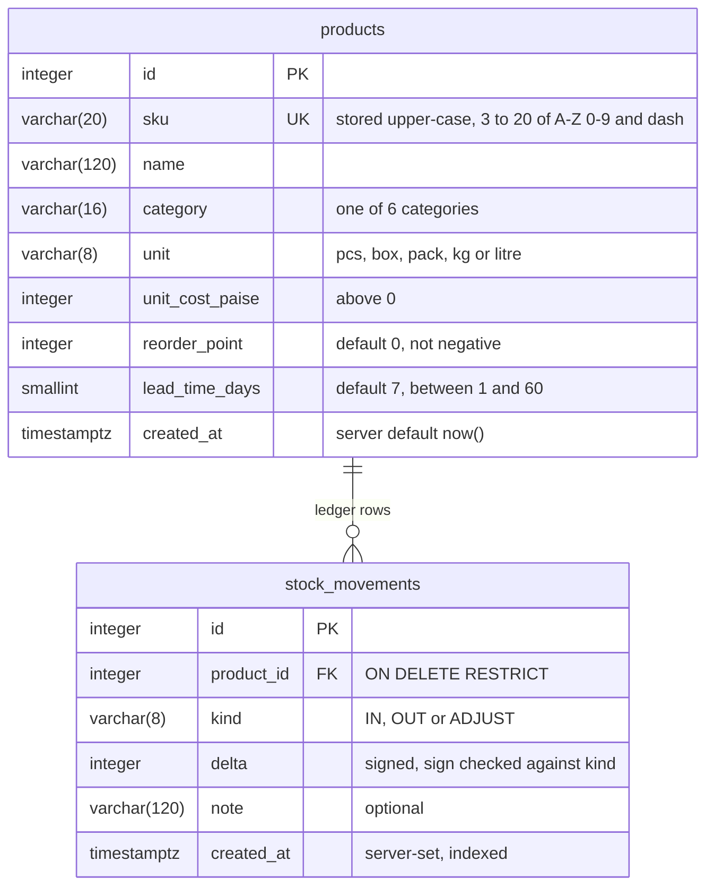
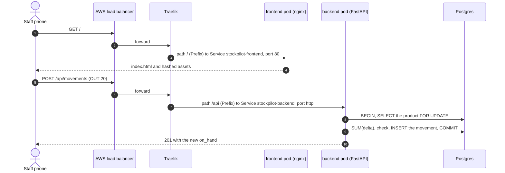
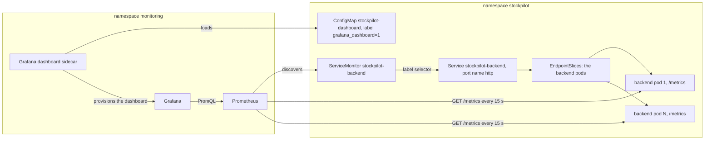

# StockPilot: architecture and design

This document is the design record of StockPilot: the problem, who uses it, what each feature must
do, the data model, the API contract, the metrics, the demo data and how requests and metrics flow
through the system. The [README](../README.md) covers how to run, test, deploy and observe it; the
[ADRs](#13-design-decisions) record why each major choice was made.

Contents:

1. [Problem](#1-problem)
2. [Users](#2-users)
3. [User stories and acceptance criteria](#3-user-stories-and-acceptance-criteria)
4. [Domain model](#4-domain-model)
5. [API contract](#5-api-contract)
6. [Configuration contract](#6-configuration-contract)
7. [Reorder planner](#7-reorder-planner)
8. [Metrics](#8-metrics)
9. [Seed data](#9-seed-data)
10. [Request flow](#10-request-flow)
11. [Metrics flow](#11-metrics-flow)
12. [Wireframe notes](#12-wireframe-notes)
13. [Design decisions](#13-design-decisions)

## 1. Problem

Small shops and godowns (a neighbourhood kirana, a stationery store, a small distributor's
storeroom) track stock in notebooks or spreadsheets. Two things go wrong:

- **Stock levels drift.** Sales and deliveries are written down late, twice or not at all, so the
  number on paper stops matching the shelf, and nobody can say which entry was wrong.
- **Fast movers run out before festivals.** Before Diwali, demand for biscuits, sugar, diyas and
  gift wrap jumps, suppliers deliver late, and the shop finds out it is out of stock when a customer
  asks. Meanwhile slow items are over-ordered.

StockPilot keeps a **ledger of stock movements** recorded from a phone at the counter, derives live
stock, stock value and days of cover from it, and runs a **Monte-Carlo reorder planner** that shows,
per product, the risk of running out during the festival period and how much to reorder.

## 2. Users

| User | Needs | Main screens |
|---|---|---|
| Store staff | Record deliveries (IN), sales and dispatches (OUT) and stock-count corrections (ADJUST) quickly on a phone; undo a mistaken entry | Record sheet, Stock, Ledger |
| Owner or manager | See what is low, what sells, the stock value, and a reorder plan before a festival | Stock (summary line), Planner, Products |
| Accountant | The inventory value in rupees, exact to the paisa, and an audit trail | Stock (summary line), Ledger |
| Operator (the DevOps side) | Know which build is running, whether it is healthy, and how it performs | `/api/version`, the UI footer, `/health`, `/ready`, `/metrics`, Grafana |

StockPilot is a trusted internal tool: there are no logins or roles in this version (see the README
limitations).

## 3. User stories and acceptance criteria

Every acceptance criterion below is checked by an automated test (files under `backend/tests/`), a CI
step, or a row of the manual QA checklist in [`docs/frontend-qa.md`](frontend-qa.md) (QA A1, B3, …).
Error texts are quoted exactly as the API returns them.

| # | Story | Acceptance criteria | Where |
|---|---|---|---|
| US-1 | As staff, I record a sale so that stock stays true. | `POST /api/movements` with `kind: OUT` and `quantity` > 0 returns 201 with the new `on_hand`. The UI toast reads, for example, `Reynolds pen (blue) −20 → 111 left`, and the stock row, its cover bar and the summary line refresh without a page reload. | `test_movements_api.py`; QA A1, B3 |
| US-2 | As staff, I cannot sell stock we do not have, even when a colleague records at the same moment. | An OUT larger than `on_hand` returns 422 `Insufficient stock: on hand N, requested M`, writes nothing, and raises `stockpilot_insufficient_stock_total` by 1. Two simultaneous OUTs on PostgreSQL can never take stock below zero. | `test_movements_api.py`, `test_metrics.py`, `test_concurrency_pg.py`; QA A2, B4 |
| US-3 | As staff, I record deliveries and stock-count corrections. | IN needs `quantity` > 0; ADJUST takes a signed, non-zero `quantity`; a note is optional (at most 120 characters). Anything else is a 422 before any write. | `test_movements_api.py`, `test_schemas.py` |
| US-4 | As staff, I undo a mistaken entry. | `DELETE /api/movements/{id}` returns 204 and `on_hand` is re-derived; 404 `Movement not found` for an unknown id; 422 `Undo would make stock negative: on hand N, movement D` when the undo would go below zero. In the Ledger, Undo needs a second tap ("Confirm undo"). | `test_movements_api.py`, `test_concurrency_pg.py`; QA B5 |
| US-5 | As the owner, I see every product's stock at a glance. | `GET /api/products` returns products ordered by SKU with `on_hand`, `value_paise`, `days_of_cover` and `needs_reorder` (`on_hand` ≤ `reorder_point`). Filters: `category`, `q` (case-insensitive on SKU or name), `below_reorder`. The cover bar is red below one lead time of cover, amber below two, green otherwise, and hatched "no demand" without OUTs in 30 days. | `test_products_api.py`, `test_stock.py`; QA B1, B2 |
| US-6 | As the owner and the accountant, I see a one-line summary. | `GET /api/summary` returns `inventory_value_paise`, `product_count`, `items_below_reorder`, `movements_24h`, `units_out_7d` and the top 5 movers by units out in 7 days. The 24 h and 7 d windows are computed in SQL. | `test_summary_api.py` |
| US-7 | As the owner, I manage the product list. | Create returns 201; a duplicate SKU in any letter case returns 409 `SKU already exists`. Update changes any field except the SKU (extra fields are rejected) and refuses an explicit `null` with 422 `<field> may not be null`. Delete returns 204 only for a product without movements, otherwise 409 `Product has stock movements and cannot be deleted`. Unknown ids return 404 `Product not found`. | `test_products_api.py`; QA B6 |
| US-8 | As the owner, I open one product. | `GET /api/products/{id}` adds the last 20 movements (newest first) and the 30-day OUT demand: total, daily average and 30 daily values. | `test_products_api.py`; QA B7 |
| US-9 | As the owner, I plan reorders before a festival. | `GET /api/reorder-plan` with a service level (50–99.9 %), a horizon (7–90 days) and a surge (0–200 %) returns every product ranked by `stockout_risk` ± `risk_margin`, with the current and recommended reorder point, the suggested order quantity and the median days to stock-out. The same `seed` reproduces the same plan. Out-of-range values return 422; a plan above the work budget returns 422 `Work budget exceeded: …`; a saturated pod returns 503 `Planner busy, retry` with `Retry-After: 5`. | `test_planner.py`, `test_reorder_plan_api.py`; QA A3, B8 |
| US-10 | As the accountant, I read the ledger. | `GET /api/movements` lists movements newest first (`id` descending), filterable by `product_id` and `kind`; each row carries the product SKU, name and unit. Rows are never edited, only undone. | `test_movements_api.py` |
| US-11 | As the operator, I know exactly which build is serving. | `GET /api/version` returns the version, the full 40-character commit SHA and the build time. The UI footer shows `ui` and `api` short SHAs and flags when they differ. The CI deploy's smoke test waits until the live SHA equals the pushed commit. | `test_meta.py`; QA B9, C2 |
| US-12 | As the operator, I can probe and scrape every pod. | `/health` answers without touching the database (liveness); `/ready` runs `SELECT 1` and returns 503 while the database is unreachable (readiness); `/metrics` serves Prometheus text with the `http_*` and `stockpilot_*` series. None of the three is routed by the Ingress. | `test_ops.py`, `test_db.py`, `test_metrics.py` |

## 4. Domain model

Two tables, created by Alembic migration `0001` and never by the application. A fixed SQLAlchemy
naming convention gives every constraint and index a stable name, so `alembic check` stays clean.

| Rule | How it is enforced |
|---|---|
| Stock is never stored: `on_hand = SUM(delta)` | No quantity column exists; every read aggregates the ledger ([ADR-0005](adr/0005-derived-stock-ledger.md)) |
| IN is positive, OUT negative, ADJUST non-zero | Pydantic validation first, then `CHECK ((kind='IN' AND delta>0) OR (kind='OUT' AND delta<0) OR (kind='ADJUST' AND delta<>0))` |
| Stock never goes below zero | Row lock on the product (`SELECT … FOR UPDATE`), sum, check, then write, in one transaction |
| History is never lost | FK `ON DELETE RESTRICT` plus an explicit `EXISTS` check that returns 409 before the delete |
| SKUs are unique in any case | Stored upper-case; `UNIQUE (sku)`; a pre-check returns 409, and the unique index catches a concurrent duplicate |
| Categories, units, costs, lead times are valid | `CHECK` constraints mirror the Pydantic `Literal` and range validators |
| Money is exact | Integer paise everywhere (`unit_cost_paise`, `value_paise`, `inventory_value_paise`); the UI formats rupees |
| Timestamps cannot be forged | `created_at` is server-set and appears in no request schema; only the seed back-dates rows |

Indexes: `ix_stock_movements_product_id_id (product_id, id)` for per-product sums and the newest-first
ledger, and `ix_stock_movements_created_at` for the 24 h, 7 d, 30 d and 60 d windows.

## 5. API contract

All business routes live under `/api`, so one Ingress rule and one nginx location route them. Swagger
UI is at `/api/docs` (OpenAPI at `/api/openapi.json`), which works through compose's nginx and through
the Ingress. Lists are bare JSON arrays.

| Method | Path | Purpose | Responses |
|---|---|---|---|
| GET | `/api/products?category=&q=&below_reorder=&limit=&offset=` | Products with live stock, ordered by `sku, id` | 200 · 422 |
| POST | `/api/products` | Create `{sku, name, category, unit, unit_cost_paise, reorder_point?, lead_time_days?}` | 201 · 409 · 422 |
| GET | `/api/products/{id}` | One product, its last 20 movements and its 30-day demand | 200 · 404 |
| PUT | `/api/products/{id}` | Partial update of any field except the SKU | 200 · 404 · 422 |
| DELETE | `/api/products/{id}` | Delete a product that has no movements | 204 · 404 · 409 |
| GET | `/api/movements?product_id=&kind=&limit=&offset=` | The ledger, newest first | 200 · 422 |
| POST | `/api/movements` | Record `{product_id, kind, quantity, note?}`; returns the new `on_hand` | 201 · 404 · 422 |
| GET | `/api/movements/{id}` | One ledger row | 200 · 404 |
| DELETE | `/api/movements/{id}` | Undo a mistaken entry | 204 · 404 · 422 |
| GET | `/api/summary` | Stock value, at/below reorder count, 24 h and 7 d activity, top 5 movers | 200 |
| GET | `/api/reorder-plan?service_level=&horizon_days=&surge_pct=&scenarios=&seed=` | Monte-Carlo reorder plan (CPU-bound) | 200 · 422 · 503 |
| GET | `/api/version` | `{version, git_sha, build_time}` of the running image | 200 |
| GET | `/health` | Liveness, no database access | 200 |
| GET | `/ready` | Readiness, `SELECT 1` | 200 · 503 |
| GET | `/metrics` | Prometheus exposition (not in the OpenAPI schema) | 200 |

That is 12 business endpoints with full GET, POST, PUT and DELETE on products, plus the three
infrastructure endpoints at the root.

**Response shapes** (field names are the contract; the frontend uses exactly these):

| Schema | Fields |
|---|---|
| `ProductStock` | `id, sku, name, category, unit, unit_cost_paise, reorder_point, lead_time_days, created_at, on_hand, value_paise, days_of_cover (float or null), movements_count, needs_reorder` |
| `ProductDetail` | `ProductStock` + `recent_movements` (up to 20) + `demand_30d {total_out, avg_daily_out, daily_out[30]}` |
| `MovementOut` | `id, product_id, sku, product_name, unit, kind, delta, note, created_at`; `MovementCreated` adds `on_hand` |
| `SummaryOut` | `inventory_value_paise, product_count, items_below_reorder, movements_24h, units_out_7d, top_movers[{product_id, sku, name, unit, units_out_7d}]` |
| `ReorderPlanOut` | `service_level, horizon_days, surge_pct, scenarios, seed, lead_time_spread[3], products_considered, work, items[PlanItem]` |
| `PlanItem` | `product_id, sku, name, unit, on_hand, avg_daily_demand, current_reorder_point, recommended_reorder_point, suggested_order_qty, stockout_risk, risk_margin, median_days_to_stockout (int or null), expected_units_short` |
| `VersionOut` | `version, git_sha (40 characters in CI builds), build_time` |

Timestamps are serialised as UTC ISO-8601 with a `Z`.

**Bounds** (violations return 422 before any work):

| Input | Bound |
|---|---|
| Product lists | `limit` 1–200 (default 50), `offset` ≥ 0, `q` at most 50 characters |
| Product fields | SKU `^[A-Z0-9-]{3,20}$` after trimming and upper-casing; name 1–120 characters; `unit_cost_paise` 1–100,000,000; `reorder_point` 0–1,000,000; `lead_time_days` 1–60; unknown fields rejected |
| Movement fields | `quantity` > 0 for IN and OUT, non-zero for ADJUST, magnitude at most 100,000; `note` at most 120 characters |
| Planner | `service_level` 50–99.9, `horizon_days` 7–90, `surge_pct` 0–200, `scenarios` 100–20,000 (default from `PLANNER_DEFAULT_SCENARIOS`), `seed` 0–2³¹−1 (random and echoed when omitted) |

**Fixed error strings:** `Product not found` · `SKU already exists` ·
`Product has stock movements and cannot be deleted` · `Insufficient stock: on hand {n}, requested {m}` ·
`Movement not found` · `Undo would make stock negative: on hand {n}, movement {d}` ·
`Work budget exceeded: …` · `Planner busy, retry` · `<field> may not be null`.

## 6. Configuration contract

Twelve-factor: every setting is an environment variable with the same name as the settings field.
Compose sets them in `docker-compose.yml`, Kubernetes through the chart's ConfigMap (non-secret) and
the `stockpilot-db` Secret (the database credentials, assembled into `DATABASE_URL`).

| Variable | Default | Meaning |
|---|---|---|
| `DATABASE_URL` | `postgresql+psycopg://stockpilot@localhost:5432/stockpilot` (no password; Compose and Helm always pass the full URL) | SQLAlchemy URL of the app database |
| `GIT_SHA`, `BUILD_TIME` | `dev`, `unknown` | Reported by `/api/version`; CI passes the commit SHA and build time as build arguments, Helm sets `GIT_SHA` |
| `PLANNER_DEFAULT_SCENARIOS` | 1000 | Scenarios when the request omits `scenarios` |
| `PLANNER_MAX_WORK` | 4000000 | Cap on scenarios × products × horizon days |
| `PLANNER_MAX_CONCURRENCY` | 2 | Planner runs computing at once per pod (the bulkhead) |
| `PLANNER_QUEUE_TIMEOUT_S` | 30 | Wait for a bulkhead slot before answering 503 |
| `LEAD_TIME_SPREAD` | `0.7,1.0,1.6` | Triangular lead-time multipliers (low, mode, high) |
| `DB_WAIT_TIMEOUT_S` | 120 | How long `app.prestart` waits for the database |
| `CORS_ORIGINS` | `http://localhost:5173` | Only the Vite dev server needs CORS; compose and Kubernetes are same-origin |
| `API_UPSTREAM` (frontend) | `backend:8000` | Where nginx proxies `/api/`; in Kubernetes the backend Service FQDN |
| `VITE_GIT_SHA` (frontend build) | `dev` | Baked into the UI bundle for the footer |

## 7. Reorder planner

`GET /api/reorder-plan` reads one snapshot (on hand, reorder point, lead time and 60 days of daily OUT
units per product), releases the database connection, and simulates each product for `scenarios`
runs: a triangular, late-skewed supplier lead time; demand bootstrapped from the product's own
history times the surge; the shop's current reorder point with one outstanding order of
`Q = max(1, ceil(d̄ · (1 + surge) · horizon_days))`; lost sales when the shelf is empty. It reports the
stock-out probability with a 95% margin, the recommended reorder point (the service-level quantile of
simulated lead-time demand), Q, the median day of the first stock-out and the expected units short,
riskiest first. The full rationale, the alternatives and the test oracle are in
[ADR-0007](adr/0007-reorder-planner-policy.md).

Example from the seeded kind cluster on 2026-10-15 (`service_level=95&horizon_days=30&seed=42`):
40 products considered, 1,200,000 day-steps of work, and the plan opens with the four items the seed
leaves short:

| SKU | On hand | Reorder point now → recommended | Order qty | Stock-out risk | Median day of stock-out |
|---|---|---|---|---|---|
| SALT-TATA-1KG | 28 | 60 → 117 | 276 | 0.982 ± 0.0082 | 4 |
| NOOD-MAGGI-70 | 49 | 90 → 211 | 623 | 0.972 ± 0.0102 | 3 |
| BIS-PARLEG | 67 | 100 → 258 | 785 | 0.941 ± 0.0146 | 3 |
| RICE-SONA | 67 | 80 → 238 | 705 | 0.897 ± 0.0188 | 4 |

The numbers move from day to day, because the 60-day window slides.

## 8. Metrics

The backend exposes two families on `/metrics` (port 8000, never routed by the Ingress):

- **HTTP series** from prometheus-fastapi-instrumentator 8.1.0: `http_requests_total{handler, method,
  status}` (status grouped as `2xx`, `4xx`, `5xx`), `http_request_duration_highr_seconds` (a
  fine-bucket histogram for percentiles), `http_request_duration_seconds` and
  `http_requests_inprogress`. Handlers are route templates such as `/api/products/{product_id}`, so ids
  never explode the label cardinality. `/metrics`, `/health` and `/ready` are excluded, so probes do not
  dilute the request rate.
- **Business series** from `app/metrics.py`, registered once at import. The only label is `kind`, and
  its three children are created at 0, so every series exists before the first movement:

| Metric | Type | Meaning | Dashboard panel |
|---|---|---|---|
| `stockpilot_movements_total{kind}` | counter | Movements recorded, counted only after the commit | 8 Stock movements |
| `stockpilot_units_moved_total{kind}` | counter | Units moved (absolute delta) | 8 Stock movements |
| `stockpilot_insufficient_stock_total` | counter | OUTs refused for lack of stock | 10 Rejected OUTs and undos |
| `stockpilot_undo_total` | counter | Movements undone | 10 Rejected OUTs and undos |
| `stockpilot_planner_seconds` | histogram (0.05 to 10 s buckets) | Planner compute time inside the bulkhead, queue wait excluded | 9 Planner p95 vs backend replicas |
| `stockpilot_planner_scenarios_total` | counter | Scenarios × products with demand, per plan | 11 Planner work and bulkhead |
| `stockpilot_planner_inflight` | gauge | Planner runs computing in this pod | 11 Planner work and bulkhead |

There are deliberately no database-backed gauges: a collector that queries the database at scrape or
import time can crash the first install before the migration has run, or turn `/metrics` into a 500.
The inventory value lives in `/api/summary` instead.

The dashboard (`helm/stockpilot/dashboards/stockpilot.json`, uid `stockpilot-overview`) has 11 panels
with 17 queries; the README lists them with their PromQL.

## 9. Seed data

`python -m app.seed` loads a believable kirana-and-stationery shop. It writes through the same stock
service as the API (never raw SQL), so every row passes the same checks as a real movement.

- **40 products** in 6 categories: grocery 11, stationery 8, personal care 6, household 6,
  electronics 5, other 4. Names are everyday Indian shop items (Classmate notebook, Reynolds pens,
  Parle-G, Maggi, Tata Salt, Surf Excel, clay diyas, gift wrap). Lead times are 5, 7, 10 or 14 days.
- **60 days of back-dated, lumpy history:** regular supplier deliveries (IN), daily sales (OUT) with
  zero days and occasional bulk orders, sales clipped to the stock on the shelf. A fresh seed writes
  2,100 movements: 344 IN, 1,751 OUT and 5 ADJUST, inserted oldest first in one transaction, so ids
  follow time and the newest-first ledger reads in date order.
- **Two stories** end in a stock-count ADJUST sized from the 30-day demand the API reports:
  - *short:* Parle-G, Maggi, Tata Salt and Sona masoori rice are left with half a lead time of cover,
    so the reorder plan opens with them;
  - *pen:* Reynolds pen (blue), `PEN-REY-BLU`, is left just above two lead times of cover, so one OUT of
    20 in the live demo turns its cover bar from green to amber (cover 15.1 → 11.9 days against a
    7-day lead time).
- **Idempotent by SKU:** re-running skips existing products, so it is safe on every bring-up. Each
  product uses its own seeded random generator, so its history does not depend on which other SKUs
  already exist.
- **`--demo-reset`:** the 30-day window slides daily, so this flag re-applies both story targets on an
  already seeded database before a demo.

Where it runs: `make seed` (compose), automatically in `make kind-deploy` (kind), and
`kubectl -n stockpilot exec deploy/stockpilot-backend -- python -m app.seed` after the first EKS
deploy. The seed moves no business counter (those are counted in the API routers, and the seed runs as
a separate process), so the live business panels come only from real UI actions.

## 10. Request flow

On EKS (kind is the same from Traefik inwards; there Traefik listens on `http://localhost:8080`):

- **Ingress:** one rule set, no host, no rewrites. Traefik matches the longer prefix first, so `/api`
  goes straight to the backend Service and everything else to the frontend.
- **Compose** has no Ingress: nginx in the frontend container proxies `/api/` to `backend:8000`. The
  same frontend image runs in Kubernetes, where `API_UPSTREAM` is the backend Service FQDN
  (`stockpilot-backend.stockpilot.svc.cluster.local:8000`) because nginx's runtime resolver ignores
  search domains. nginx resolves it per request, so it starts even while the backend is down.
- **Backend:** one uvicorn worker per pod, a pooled connection per request (5 + 5 overflow per pod,
  which keeps 5 replicas under PostgreSQL's default 100 connections). The planner endpoint is a plain
  `def` that runs in the threadpool behind a per-pod bulkhead, so `/health` (async) keeps answering
  while plans compute.
- **Schema changes** never happen in a serving pod: a Helm hook Job runs `alembic upgrade head`
  (post-install and pre-upgrade) under a PostgreSQL advisory lock, before new pods start.

## 11. Metrics flow

Prometheus pulls; nothing pushes. kube-prometheus-stack runs in namespace `monitoring`, and its
Prometheus selects ServiceMonitors in every namespace.

1. The chart's ServiceMonitor selects the backend Service by its labels and names the endpoint by the
   port name `http`, not a number.
2. The Prometheus operator turns that into a scrape pool, `serviceMonitor/stockpilot/stockpilot-backend/0`,
   with one target per backend pod; when the HPA adds pods, targets appear without any change.
3. Prometheus scrapes each pod every 15 seconds; `up{namespace="stockpilot"}` shows each target.
4. Grafana queries Prometheus; its sidecar loads the dashboard ConfigMap that the chart ships, so the
   dashboard is code, versioned with the app.
5. Prometheus and Grafana are never exposed publicly: they are reached with `kubectl port-forward`.

The chart renders the ServiceMonitor only when the cluster serves its CRD
(`.Capabilities.APIVersions.Has "monitoring.coreos.com/v1/ServiceMonitor"`), so a deploy before the
monitoring stack never fails; the bootstrap scripts install monitoring before the app.

## 12. Wireframe notes

The UI follows a "warehouse ledger" look: ruled rows, tabular figures, one hi-vis action colour. It
is mobile-first: a phone is the main device at the counter.

| Screen | Phone (375 px) | Desktop (1440 px) |
|---|---|---|
| Navigation | Fixed bottom tab bar: Stock, Record, Ledger, Planner, Products, each at least 44 × 44 px | Tabs in the header; Record movement is the hi-vis button on the right |
| Stock (home) | Search box, category chips, the one-line summary, then one card per product: SKU, name, Reorder tag, on hand with unit, value in ₹, the days-of-cover bar and a Record button | The same content as ruled table rows |
| Record sheet | Bottom sheet: product search, IN / OUT / ADJUST segmented control, quantity stepper, note; server errors such as insufficient stock appear inline under the quantity | The same sheet docked on the right |
| Ledger | Newest-first movements grouped by day, each with an Undo that needs a second tap to confirm | Table with the same columns |
| Planner | Service-level slider (80–99 %), horizon segmented control (14, 30, 60 days), surge chips (No surge, +20 %), "Run simulation"; then rows ranked by risk with a risk ± margin bar, reorder point now vs recommended, order quantity and median stock-out day | The same, as a wide table |
| Products | One row per product with Edit and Delete; Delete asks for confirmation, and is disabled with the visible hint "Has N movements — kept for the audit trail" when the product has history. New product opens the form page (`/products/new`), which shows the server's validation messages inline | The same, as a table |
| Product detail | Spec sheet (on hand, value, unit cost, reorder point, lead time, days of cover), the last 20 movements and a "Full ledger →" link | The same |
| Footer | `StockPilot v1.0.0 · ui sha7 · api sha7`; "builds differ" while a rolling update is in progress | The same |

The days-of-cover bar spans 0 to three lead times with ticks at one and two lead times: red below one
lead time of cover, amber below two, green above, hatched when there was no demand in 30 days. An
API-down banner ("Can't reach the StockPilot API — showing the last data loaded") replaces error
pages, and the data reloads by itself when the API comes back.

Deliberately avoided, so the product looks nothing like a task tracker: no sidebar or drawer, no
stat cards, no status-filter pills, no activity feed, no centred modal, no greeting or profile block.

## 13. Design decisions

| ADR | Decision |
|---|---|
| [0001](adr/0001-application-stack.md) | Application stack: FastAPI, PostgreSQL 18, React + Vite, Alpine-based non-root images |
| [0002](adr/0002-traefik-ingress.md) | Traefik as the Ingress controller on kind and EKS; ALB as the documented alternative |
| [0003](adr/0003-github-oidc-deploy.md) | Deploy through GitHub OIDC with no stored AWS keys |
| [0004](adr/0004-in-cluster-postgres.md) | PostgreSQL as an in-cluster StatefulSet rather than RDS |
| [0005](adr/0005-derived-stock-ledger.md) | Stock derived from a movement ledger, never stored |
| [0006](adr/0006-sha-pinned-actions.md) | Every GitHub Action pinned to a full commit SHA |
| [0007](adr/0007-reorder-planner-policy.md) | Planner simulates the shop's (s, Q) policy with Q covering the horizon |
